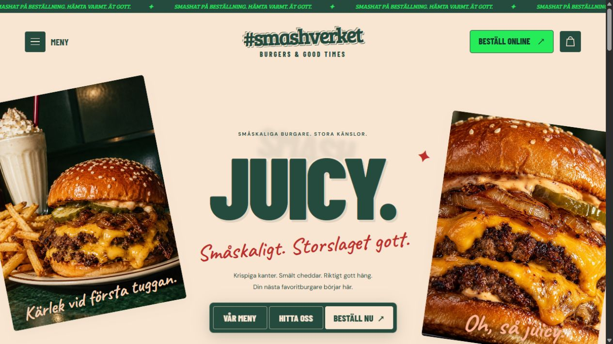
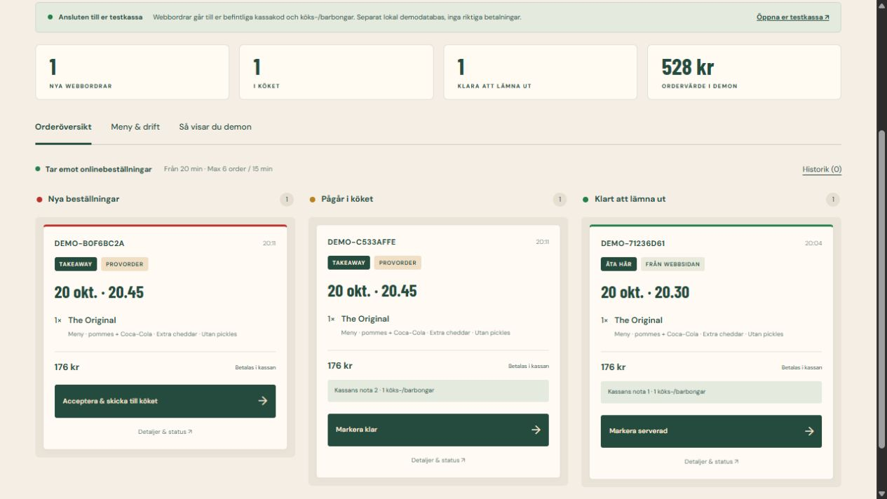

# Smashverket · Burger restaurant template



En färdig svensk restaurangmall för en mindre burgarkedja. Saltbae Burger är huvudreferensen för gräddfärg, skogsgrönt, stora rubriker, handskrivna detaljer och sneda matbilder. Namn, restauranger, adresser, priser och innehåll är exempel.

Mallen har responsiv startsida, digital meny, vegetariskt filter, produktanpassning, varukorg och tidsval för takeaway eller **Äta här**. Ett fungerande demoflöde binder ihop gästens beställning, restaurangens orderöversikt, tillagning och gästens orderstatus. Personalen kan ändra pris, slutsålt, ledtid, paus och kapacitet per restaurang.

**Alla beställningar är testorder. Inga riktiga betalningar, SMS eller mejl genomförs.**

- [Öppna restaurangsidan](https://burger-demo-site.vercel.app/)
- [Öppna restaurangens orderöversikt](https://burger-demo-site.vercel.app/demo/)
- [Visa demon på två minuter](DEMO-GUIDE.md)

Den publika demon delar data mellan flikar i samma webbläsare. Det finns också en **verifierad lokal anslutning till ert befintliga kassasystem**, med en egen testdatabas, riktiga testnotor och köks-/barbongar. Kökets status läses tillbaka till gästen. Se [POS-INTEGRATION.md](POS-INTEGRATION.md) för start och produktionsgränser.



## Starta lokalt

Använd Node.js 24. Inga tredjepartsberoenden behövs för webbplatsen.

```sh
npm ci
npm run dev
```

Öppna <http://127.0.0.1:5187> och <http://127.0.0.1:5187/demo/>. `PORT` kan ändra porten. `npm run build` kör kontroller och tester och bygger till `build/`. `dist/` innehåller de redigerbara källfilerna, även om katalognamnet heter dist.

Mobilförhandsgranskning finns lokalt på <http://127.0.0.1:5187/_preview?width=390>. Denna hjälprutt finns bara i utvecklingsservern och publiceras inte till Vercel.

För en kombinerad visning med kassaprojektet, använd dess befintliga installation:

```powershell
npm run demo:pos -- --pos-project 'C:\sökväg\till\lagustosa-kassa'
```

Det startar gästsidan på port **5197**, orderöversikten på **5197/demo/** och er befintliga testkassa på **5196**. Varje start skapar en separat demodatabas. Vanliga kassadata och kassans källkod ändras inte.

## Publicera på Vercel

1. Importera GitHub-repot `elias-b33/burger-demo-site` på Vercel.
2. Använd repots rot som **Root Directory** och **Other** som framework.
3. `vercel.json` anger **Build Command** `npm run build`, **Output Directory** `build` och **Install Command** `npm ci --ignore-scripts`.
4. Tryck **Deploy**. Demon behöver inga miljövariabler eller nycklar.

Valfri `SITE_URL=https://din-domän.se` ger absoluta delningsbilder för egen domän. Annars använder bygget Vercels automatiska URL-variabler. Demoversionen har `noindex`; sätt `restaurant.demo` till `false` först när den riktiga restauranginformationen och ordermottagningen är klara.

Vercel serverar de statiska filerna och webbläsardemon utan hemligheter. `server.mjs` och POS-adaptern körs lokalt. En skarp tjänst som ska ta emot order från olika kunders enheter behöver en driftsatt ordermottagare; den publika statiska demon ansluter inte till er ordinarie kassa.

## Anpassa för en ny restaurang

Ändra `dist/restaurant.config.js`: varumärke, färger, restauranger, öppettider, ledtid, meny, priser, tillval och Foodora-länkar. Ta bort eller lägg till restaurangobjekt för en eller två enheter. Priser anges i **öre**, exempelvis `11900` för 119 kr. Byt även matbilder och redaktionell text i `dist/index.html` efter behov.

Se [IMPLEMENTATION.md](IMPLEMENTATION.md) för anpassning, [POS-INTEGRATION.md](POS-INTEGRATION.md) för kassakopplingen och [DESIGN-RESEARCH.md](DESIGN-RESEARCH.md) för design- och funktionsbesluten. Bildkällor och genereringsprompter finns i [ASSETS.md](ASSETS.md).

## Verifiering

```sh
npm run check
npm run build
```

Bygget täcker tillval och totalsummor, antal, öppettider och sommartid, kassavalidering, Foodora-adresser och lokala resurser. Tolv ytterligare tester verifierar demoflödet: idempotens, kapacitet, paus, slutsålt, prisändring, otillåtna rader, statusövergångar och POS-mappning.

Kassaintegrationen verifieras separat mot det befintliga projektet:

```powershell
npm run verify:pos -- --pos-project 'C:\sökväg\till\lagustosa-kassa'
```

Takeaway och Äta här har provats i webbläsare. En Äta här-order med meny, extra cheddar och utan pickles har gått från gästsidan till kassans befintliga köksvy och tillbaka till gästens klarstatus. Pris- och slutsåltändringar har följts över flikar.

Mobilens komposition och formulär har ett separat presentationslager i `dist/mobile.css`. Startsidan och kassan har kontrollerats vid 320, 360, 390, 430, 600 och 760 pixlar utan horisontellt överflöde. Produktval, restaurangval, varukorg, orderstatus, navigation och driftreglage har också granskats. Ett mobilköp med tio menyer och extra cheddar, totalt 1 960 kr, har skickats och bekräftats från restaurangvyn. Datorns startsida har granskats vid 1280 pixlar. Pilar och bockar ritas med lokala SVG-filer för samma utseende på olika telefoner.
